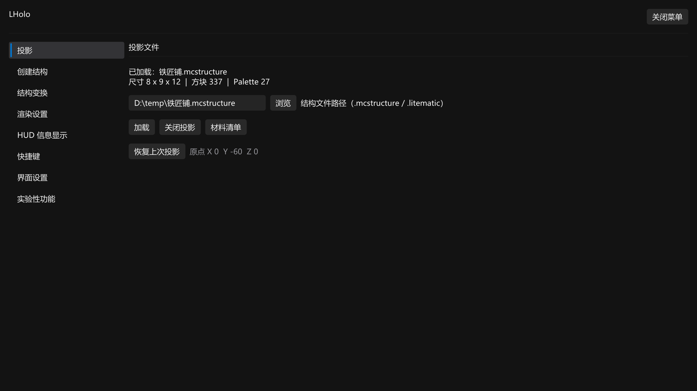
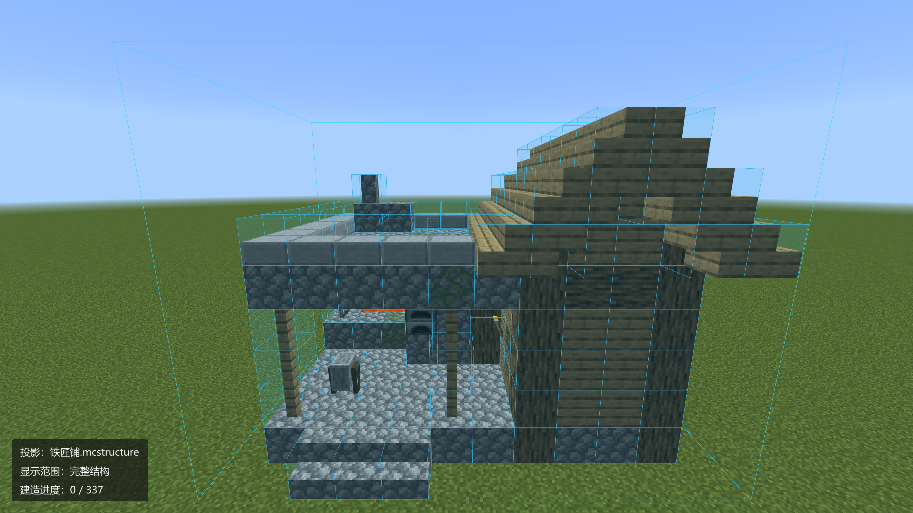
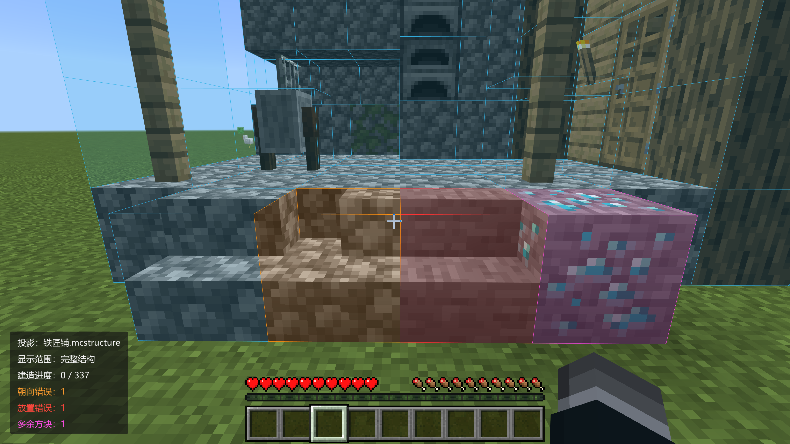
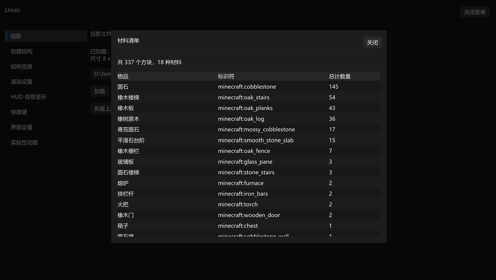
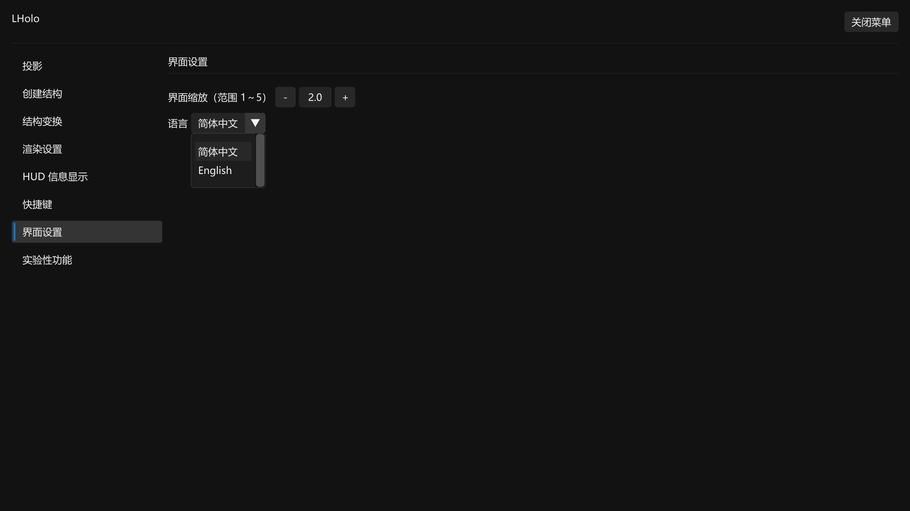

# LHolo

[English](docs/README_EN.md)

`LHolo` 是一个 [LeviLamina](https://github.com/LiteLDev/LeviLamina) 客户端投影模组

当前 `main` 对应 Minecraft Bedrock Windows `1.26.60.05`、LeviLamina `26.60.0 client`，模组版本为 `26.60.0`。26.51 版本维护在 [backport/26.51](https://github.com/MarmieQi/LHolo/tree/backport/26.51)。

## 开发架构

聊天命令与菜单快捷键打开同一 OreUI 主菜单，默认进入建造任务页；文件加载、关闭投影、材料清单和独立原生结构预览均从任务页进入。创建结构、结构变换、渲染设置、HUD、快捷键、语言和实验性设置继续使用现有业务模块。HUD、布局编辑器和结构预览使用原生绘制，ImGui 保留动作提示及后端输入；旧 ImGui 菜单已移除。
开发入口见 [开发手册](DEVELOPMENT.md)、[OreUI 架构与迁移说明](docs/OREUI_MIGRATION.md) 和 [前端说明](frontend/README.md)。

## 本机构建完整模组目录

配置一次目标游戏资源路径后，执行 `xmake`，完整输出到 `bin/LHolo/`，可复制到游戏 `mods/`；不生成 ZIP。默认 `xmake` 同时构建原生与前端资源。配置方法与公开发行边界见 [构建与打包说明](docs/OREUI_PACKAGING.md)。

## 版本号说明

示例版本：`v26.60.2`

- `26.60`：对应的 Minecraft 游戏版本
- `.2`：模组在该游戏版本下的第 2 个版本

## 快速上手

[安装教程](https://www.bilibili.com/opus/1239631121935761412)

1. 安装本模组以后，聊天栏输入 `LHolo` 打开 OreUI 菜单，或按 `Alt + M` 打开同一主菜单
2. 本模组交互为GUI与快捷键(具体快捷键直接看模组菜单)
3. 使用本模组时,请关闭灵动视效

## 主要功能

**文件支持**

- 支持 `.mcstructure` 和 `.litematic`(Java 版 Litematica 蓝图)两种文件

**纠错**

- 蓝色 = 未放置投影方块
- 红色 = 方块放置错误
- 黄色 = 朝向或状态错误
- 品红色 = 多余方块

**分层建造**

- X或Y轴分层显示
- 材料分层显示

**结构变换**

- 移动
- 旋转 
- 镜像

**HUD 信息显示**

- 屏幕角落可显示:蓝图文件名、当前显示的层、建造进度(已放/总数)、各类错误数量、当前辅助放置模式等。
- 位置可放在屏幕四角,每一项都能单独开关。

**多语言支持**

- 简体中文
- English

## 模组演示

**模组菜单页面**

**加载结构**

**纠错**

**材料清单**

**语言设置**

入口：打开模组主菜单 -> 界面设置 -> 语言

****
