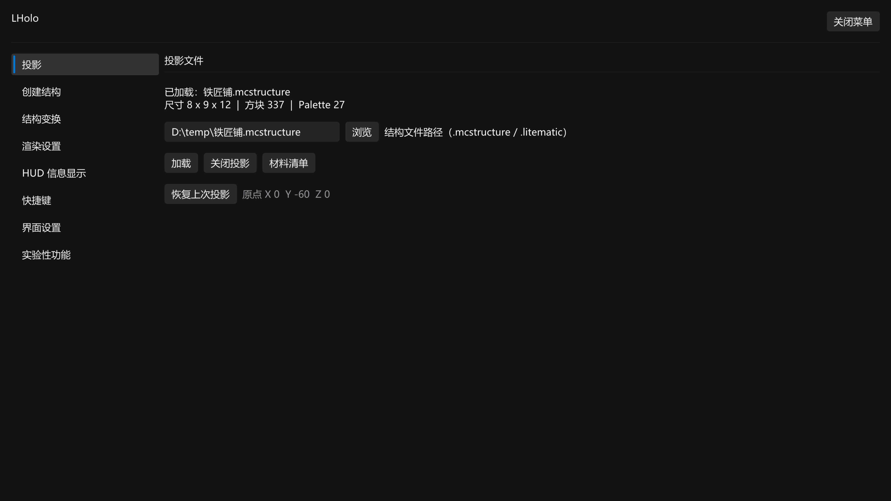
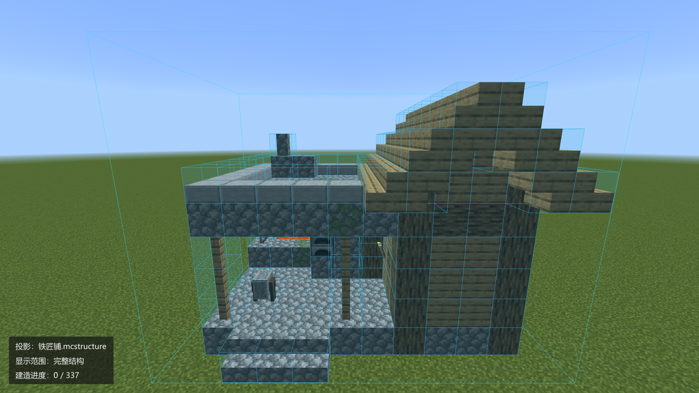
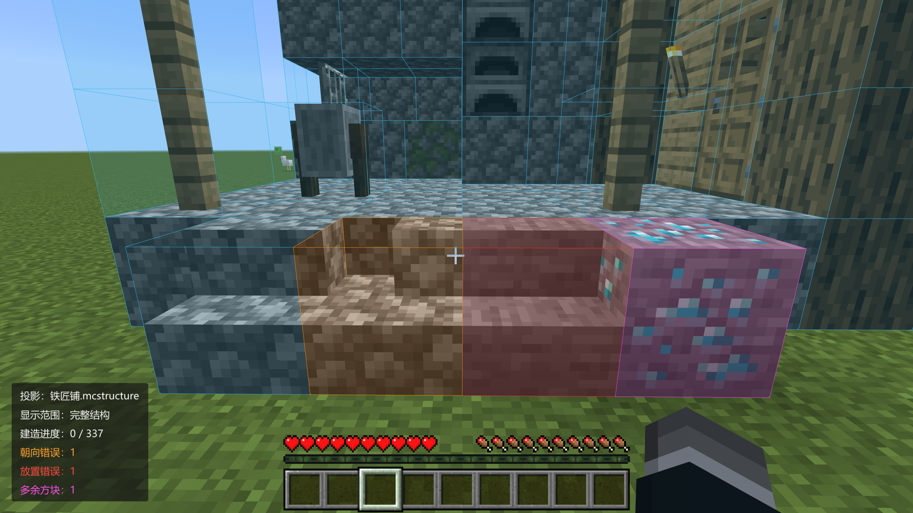
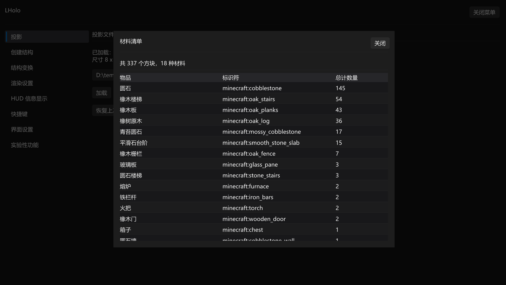
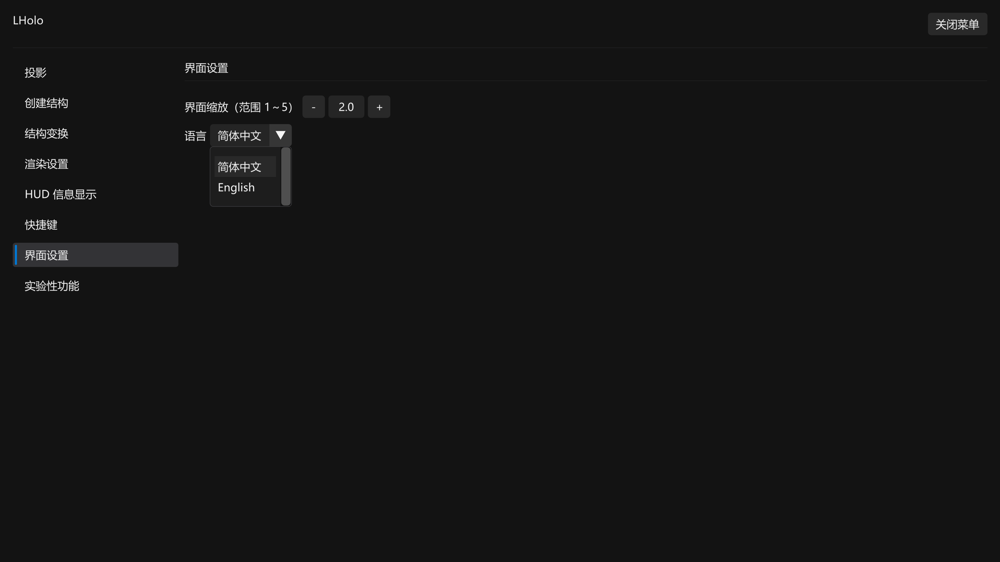

# LHolo

[简体中文](../README.md)

`LHolo` is a client-side structure projection mod for [LeviLamina](https://github.com/LiteLDev/LeviLamina)

The current `main` branch targets Minecraft Bedrock Windows `1.26.60.05` and LeviLamina `26.60.0 client`, with mod version `26.60.0`. The 26.51 version is maintained on [backport/26.51](https://github.com/MarmieQi/LHolo/tree/backport/26.51).

## Development architecture

Chat `LHolo` and the configured menu hotkey (Alt+M by default) open the same OreUI menu on the building tasks page. Task files provide projection loading, closing, material lists and independent native previews. Capture, transforms, render settings, HUD, hotkeys, language and experimental settings use the existing native business modules. OreUI renders action hints. The HUD, layout editor and structure preview use native rendering. WindowHotkeys handles Windows shortcuts. See the [development guide](../DEVELOPMENT.md),
[OreUI migration architecture](OREUI_MIGRATION.md), and [frontend guide](../frontend/README.md) (Chinese).

## Versioning

Example version: `v26.60.2`

- `26.60`: the corresponding Minecraft game version
- `.2`: the mod's second version for that game version

## Quick Start

1. After installing the mod, type `LHolo` in chat for the OreUI menu, or press `Alt + M` for the existing functional menu
2. The mod is operated through a GUI and hotkeys (for the full hotkey list, just check the mod menu)
3. Please disable Vibrant Visuals while using this mod

## Main Features

**Supported files**

- Both `.mcstructure` and `.litematic` (Java Edition Litematica schematics) files

**Correction**

- Blue = projected block not placed yet
- Red = wrong block placed
- Yellow = wrong orientation or block state
- Magenta = extra block

**Layered building**

- Slice the structure along the X or Y axis
- Layer display grouped by material

**Structure transforms**

- Move
- Rotate
- Mirror

**HUD display**

- The screen corners can show: the schematic file name, the layer currently displayed, build progress (placed / total), counts of each error type, the current assisted placement mode, and more.
- The HUD can sit in any of the four screen corners, and every item can be toggled on or off individually.

**Language**

- 简体中文 (Simplified Chinese)
- English

## Showcase

**Mod menu**

**Loading a structure**

**Correction**

**Material list**

**Language setting**

How to find it: open the mod main menu -> Interface -> Language

